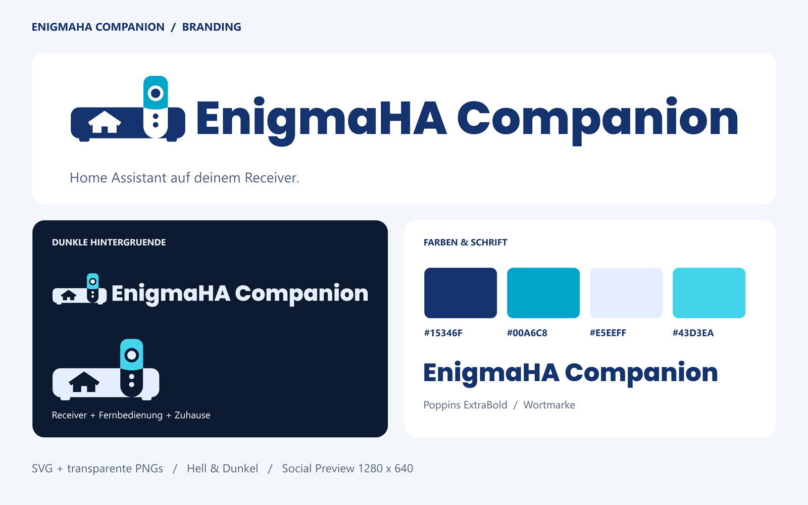

# EnigmaHA Companion – Branding



Der Auftritt übernimmt Receiver, Fernbedienung, Dunkelblau und die kräftige
Poppins-Wortmarke von **enigma2-connect**. Das Haus als Aussparung im Receiver
und der Cyan-Akzent kennzeichnen EnigmaHA Companion. Das Haus ist ein eigenes
Symbol; es wird kein offizielles Home-Assistant-Logo verwendet.

## Fertige Dateien

| Verwendung | Datei / Ordner | Format |
| --- | --- | --- |
| HA-Icon, heller Hintergrund | `../../custom_components/enigmaha_companion/brand/icon.png`, `icon@2x.png` | 256 / 512 px, transparent |
| HA-Icon, dunkler Hintergrund | gleicher Ordner: `dark_icon.png`, `dark_icon@2x.png` | 256 / 512 px, transparent |
| Logo, heller Hintergrund | gleicher Ordner: `logo.png`, `logo@2x.png` | 128 / 256 px hoch, transparent |
| Logo, dunkler Hintergrund | gleicher Ordner: `dark_logo.png`, `dark_logo@2x.png` | 128 / 256 px hoch, transparent |
| Vektoren | [`source/`](source/) | SVG, Wortmarke als Pfade |
| GitHub Social Preview | [`social-preview.png`](social-preview.png) | 1280 × 640 px, weißer Hintergrund |
| Branding-Übersicht | [`brand-overview.png`](brand-overview.png) | 1600 × 1000 px |

Die acht HA-PNGs und die zugehörigen Herkunfts-/Lizenzhinweise werden automatisch
in die Installations-ZIPs übernommen.
`brand/icon.svg` entspricht `source/icon.svg`. Die Schrift und die
Branding-Übersicht gehören nur zu den Entwicklungsquellen, nicht zum HA-Paket.

## Farben und Schrift

| Rolle | Heller Hintergrund | Dunkler Hintergrund |
| --- | --- | --- |
| Symbol und Wortmarke | Navy `#15346F` | Eisblau `#E5EEFF` |
| Fernbedienung / Akzent | Cyan `#00A6C8` | Helles Cyan `#43D3EA` |
| Empfohlener Hintergrund | Weiß `#FFFFFF` | Nachtblau `#0D1B32` |
| Begleittext | Schiefer `#536583` | Eisblau `#E5EEFF` |

Wortmarke: **Poppins ExtraBold**. Begleittext: **Segoe UI**, alternativ die
Systemschrift. Projektname: **EnigmaHA Companion**. Claim:
**Home Assistant auf deinem Receiver.**

Proportionen und Farben beibehalten. Um das Logo mindestens die Höhe des
Fernbedienungsrings freilassen; beim Icon die vorhandene quadratische Fläche
verwenden. Aussparungen bleiben transparent. Keine Schatten, Verläufe oder
zusätzlichen Umrandungen hinzufügen. Für kleine Ansichten das Icon statt der
gesamten Wortmarke verwenden; empfohlene Mindestbreite des Logos: 320 px.

## Reproduzierbarer Export

Aus dem Projektstamm unter Windows mit Windows PowerShell 5.1 ausführen:

```powershell
powershell.exe -NoProfile -ExecutionPolicy Bypass -File assets/branding/export.ps1
```

Der Export konstruiert die Vektorpfade und rendert PNGs mit `System.Drawing`
und dreifachem Supersampling. Alle fertigen Dateien sind ohne installierte
Schrift nutzbar. Die SVGs enthalten weder externe Ressourcen noch Textknoten.
Der Export überschreibt die erzeugten SVGs und PNGs; Form und Layout deshalb
in `export.ps1` ändern und anschließend die Vorschauen prüfen.

Nur die Social Preview neu erzeugen:

```powershell
powershell.exe -NoProfile -ExecutionPolicy Bypass -File assets/branding/export.ps1 -SocialOnly
```

In GitHub unter **Repository → Settings → General → Social preview → Edit →
Upload an image** die Datei `social-preview.png` hochladen. Die Einstellung
wird durch die Datei im Repository allein nicht gesetzt. Eine Neueinrichtung
der Integration oder des Receivers ist für die Branding-Änderung nicht nötig.

## Herkunft und Lizenzen

Receiver-/Fernbedienungsform und Exportbasis stammen aus
[`topic2k/enigma2-connect`](https://github.com/topic2k/enigma2-connect),
Copyright 2026 Enigma2 Connect contributors, Apache-2.0. Für Companion wurden
Hausmotiv, Palette, Wortmarke, Layout und Export ergänzt bzw. angepasst.
Siehe [NOTICE](NOTICE) und [Lizenztext](LICENSE-enigma2-connect.txt).

Poppins ExtraBold: Copyright 2020 The Poppins Project Authors,
[SIL Open Font License 1.1](source/OFL-Poppins.txt). Die Schriftdatei wurde aus
dem Branding-Quellordner des Referenzprojekts übernommen; ursprüngliche Quelle:
[Google Fonts / Poppins](https://github.com/google/fonts/tree/main/ofl/poppins).
Segoe UI wird als Windows-Systemschrift ausschließlich beim Export verwendet
und nicht als Schriftdatei mitgeliefert.
